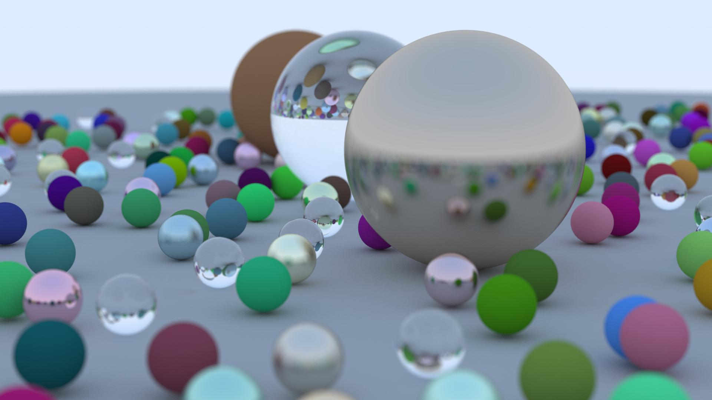

# Accelerated Ray Tracing With CUDA

My implementation of an accelerated ray tracer using CUDA. This project is based on Peter Shirley's ebook [Ray Tracing in One Weekend](https://raytracing.github.io/books/RayTracingInOneWeekend.html "Ray Tracing in One Weekend") and Roger Allen's blog [Accelerated Ray Tracing in One Weekend in CUDA.](https://developer.nvidia.com/blog/accelerated-ray-tracing-cuda/ "Accelerated Ray Tracing in One Weekend in CUDA").

This is a simple and straightforward translation from C++ to CUDA, without any further acceleration techniques. Nonetheless, performance gains are very impressive. My machine, with 1920x1080 pixels and 500 samples per pixel, took about 99 seconds to render the image below. With the traditional un-accelarated CPU ray tracer and the same settings, the same image rendered in more than 45 minutes. That is more than 27x the speedup!

